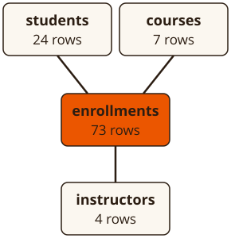

# Lab 1: Same question, two systems

You explore the registration system, ask the Dean's question of two designs, and write the questions the warehouse must answer.

| | |
|---|---|
| Learning outcomes | LO1 |
| You build | component 1, Registration system (shown), and component 2, Requirements |
| Input | `d1_registration.sql`, loaded into the database `thara` by the starter kit |
| Today's deliverable | one-page scenario and three questions the warehouse must answer |

## Before you start

1. **Check your setup.** Double-click `setup\0_check_setup.bat`. *Expected:* every line says PASS, including the line for `days\day-1\sql\d1_registration.sql`. If a line says FAIL, do what it says, then run the check again.
2. **Start PostgreSQL.** Double-click `setup\1_start_postgres.bat`, and keep its window open. *Expected:* a PASS line that says the registration system is loaded, or that `thara` holds it.
3. **Start DBeaver.** Double-click `setup\2_start_dbeaver.bat`, then open the connection **thara (DWBI kit)**. *Expected:* the database `thara`, with the schemas `registration` and `warehouse`.
4. **Check your input.** Open an SQL editor on `thara` and run `SELECT COUNT(*) FROM registration.enrollments;` *Expected:* `73`. If it does not return 73, load the file again. Double-click `setup\open_psql.bat`, run `psql -d thara -f ..\days\day-1\sql\d1_registration.sql`, then run the count again.

## Objective

At the end of this lab you have seen the same question answered by two designs, and you have counted the joins each one needs. You also have three questions the warehouse must answer, and Day 2 tests its star schema against them.

> **Quick check.** The Dean asks whether student 3001 has a grade for Database Systems this term. What kind of question is that?
>
> - [ ] A warehouse question, because the Dean asks it
> - [x] A look-up of one record, so an OLTP question
> - [ ] A warehouse question, because it names a course
>
> **Why:** The question finds one enrollment. A look-up of one record is an OLTP question, even when a manager asks it. A warehouse question compares terms or groups many rows.

## Steps

Every step says what to run, what you should see, and what to do if you do not see it. If you do not see the expected result, stop and fix that step before you go on. Run every step in the same SQL editor.

*Exercise 1: Explore the registration system*

1. **Point the editor at the registration system.** Open an SQL editor on the database `thara` in DBeaver, and run:
   `SET search_path TO registration;`
   *Expected:* DBeaver reports `SET`.
   *If it fails:* `syntax error at or near "path"` means a word is missing. The setting is one word, search_path, with an underscore.
2. **Count the rows in each of the four tables.**
   ```sql
   SELECT 'students' AS table_name, COUNT(*) AS row_count FROM students
   UNION ALL SELECT 'courses', COUNT(*) FROM courses
   UNION ALL SELECT 'instructors', COUNT(*) FROM instructors
   UNION ALL SELECT 'enrollments', COUNT(*) FROM enrollments;
   ```
   *Expected:* four rows: `students | 24`, `courses | 7`, `instructors | 4` and `enrollments | 73`.
   *If it fails:* `relation "students" does not exist` means the editor is not pointed at the registration system. Run Step 1 again in the same editor.
3. **Open the diagram of schema `registration`.** Right-click the schema, then choose View Diagram.
   *Expected:* four tables. `enrollments` has three lines, to `students`, `courses` and `instructors`.
   *If it fails:* a diagram with one table and no lines means you opened a table, not the schema. Right-click `registration` itself.

   
4. **Ask the desk's kind of question.** Is student 3003 enrolled in course 2002 in Semester 1 of 2024/2025?
   ```sql
   SELECT enrollment_id, grade
   FROM enrollments
   WHERE student_id = 3003 AND course_id = 2002
     AND semester = 'Semester 1' AND academic_year = '2024/2025';
   ```
   *Expected:* one row: `5008 | A`.
   *If it fails:* `(0 rows)` means a value is typed differently from the data. The academic year is written 2024/2025, with a slash, and the semester is Semester 1.

*Exercise 2: Ask the Dean's question twice*

5. **Ask the Dean's question for one term.** How many students enrolled in each course in Semester 1 of 2024/2025?
   ```sql
   SELECT c.course_name, COUNT(*) AS enrolled
   FROM enrollments e
   JOIN courses c ON c.course_id = e.course_id
   WHERE e.semester = 'Semester 1' AND e.academic_year = '2024/2025'
   GROUP BY c.course_name
   ORDER BY enrolled DESC, c.course_name;
   ```
   *Expected:* six rows, from `Database Systems | 9` down to `Marketing Principles | 3`, and `(6 rows)`.
   *If it fails:* `must appear in the GROUP BY clause` means GROUP BY is missing. Every column you select beside COUNT must be named in GROUP BY.
6. **Keep the courses that had no enrollment that term.** Start from courses and use a left join.
   ```sql
   SELECT c.course_name, COUNT(e.enrollment_id) AS enrolled
   FROM courses c
   LEFT JOIN enrollments e ON e.course_id = c.course_id
        AND e.semester = 'Semester 1' AND e.academic_year = '2024/2025'
   GROUP BY c.course_name
   ORDER BY enrolled DESC, c.course_name;
   ```
   *Expected:* seven rows, ending with `Networking Fundamentals | 0`.
   *If it fails:* `Networking Fundamentals | 1` means you wrote COUNT(*), which counts the course row itself. Count e.enrollment_id, which is empty when no enrollment matched.
7. **Ask for the campus, which the Dean's second question needs.**
   `SELECT campus FROM students;`
   *Expected:* an error: `ERROR: column "campus" does not exist`. The registration system does not hold campus.
   *If it fails:* `relation "students" does not exist` instead means the editor lost the schema. Run Step 1 again, then this step.
8. **Build one flat table in schema `warehouse`.** Join every enrollment once to its student and course.
   ```sql
   CREATE TABLE warehouse.enrollment_flat AS
   SELECT e.enrollment_id, s.first_name, s.last_name, c.course_name, c.department,
          e.semester, e.academic_year, e.grade
   FROM enrollments e
   JOIN students s ON s.student_id = e.student_id
   JOIN courses c ON c.course_id = e.course_id;
   ```
   *Expected:* DBeaver reports `SELECT 73`: one row for each enrollment.
   *If it fails:* `relation "enrollment_flat" already exists` means you ran this step before. Run Step 10 to drop the table, then run this step again.
9. **Ask the Dean's question of the flat table.** It needs no join.
   ```sql
   SELECT course_name, COUNT(*) AS enrolled
   FROM warehouse.enrollment_flat
   WHERE semester = 'Semester 1' AND academic_year = '2024/2025'
   GROUP BY course_name
   ORDER BY enrolled DESC, course_name;
   ```
   *Expected:* the same six rows as Step 5, from `Database Systems | 9`, with no join.
   *If it fails:* `relation "enrollment_flat" does not exist` means the schema name is missing. Write warehouse.enrollment_flat, because the editor points at registration.
10. **Drop the flat table, so schema `warehouse` is empty again for Day 2.**
    `DROP TABLE warehouse.enrollment_flat;`
    *Expected:* DBeaver reports `DROP TABLE`.
    *If it fails:* `table "enrollment_flat" does not exist` means it is already dropped. Go on: the Prove it check confirms the schema is empty.

*Exercise 3: Turn the voices into requirements*

Work in pairs. Read what the Dean, the Registrar and the Head of Computing ask, in [the scenario](../../scenario/organisation.md#3-the-three-voices). Write three questions the warehouse must answer. For each one, name the data it needs and the shape of the answer. Say why the registration system cannot answer it well.

You are finished when you have one page: the scenario in two sentences and three questions. Each question compares terms or groups many rows, and none is a look-up of one record.

If you are stuck, start from the Dean's question in Step 5. Ask it for every term, then by campus, and say which system holds each piece.

## Prove it

Run these three checks in the same editor, and paste the output into your evidence.

```sql
SELECT 'students' AS table_name, COUNT(*) AS row_count FROM students
UNION ALL SELECT 'courses', COUNT(*) FROM courses
UNION ALL SELECT 'instructors', COUNT(*) FROM instructors
UNION ALL SELECT 'enrollments', COUNT(*) FROM enrollments;
```

*Expected:* `students | 24`, `courses | 7`, `instructors | 4`, `enrollments | 73`.

```sql
SELECT COUNT(*) AS missing_grades
FROM enrollments
WHERE grade IS NULL
  AND NOT (semester = 'Semester 2' AND academic_year = '2024/2025');
```

*Expected:* `missing_grades` is `4`: grades nobody entered for terms that have ended.

```sql
SELECT COUNT(*) AS warehouse_tables
FROM information_schema.tables
WHERE table_schema = 'warehouse';
```

*Expected:* `warehouse_tables` is `0`.

## Break it

Try to record the same enrollment twice.

```sql
INSERT INTO enrollments VALUES (5100, 3001, 2001, 4001, 'Semester 1', '2024/2025', '2024-09-01', NULL);
```

You see `duplicate key value violates unique constraint "enrollments_one_per_term"`. The error names the constraint that allows one enrollment per student, course and term. There is nothing to undo. The registration system refused the row, so duplicates can only come from outside it.

## If your result is wrong

The correct output of today is in `reference/`: [d1_requirements_reference.md](reference/d1_requirements_reference.md) is a worked page of three questions. Compare it with yours and carry on. You may use it whenever you need to, and it costs you no marks. It means one bad result never blocks the rest of your week.

If the counts in Prove it differ, load the registration system again. Double-click `setup\open_psql.bat` and run `psql -d thara -f ..\days\day-1\sql\d1_registration.sql`. It rebuilds schema `registration` only.

## Today's deliverable

one-page scenario and three questions the warehouse must answer. Keep it as one page, on paper or as a document, and bring it to Day 2.

## Evidence

- Screenshots of the results of Steps 2, 5 and 9.
- Your one-page scenario with the three questions.

## Thara connection

The Dean asked how many students enrolled in each course, per term and per campus, over two years. Today you saw why the registration system answers that slowly, and why it cannot answer by campus at all. The Dean will ask whether your three questions cover that request. The Registrar will ask which source holds each piece of data.
