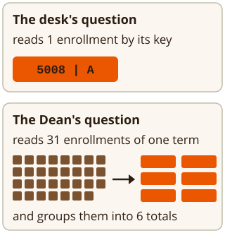
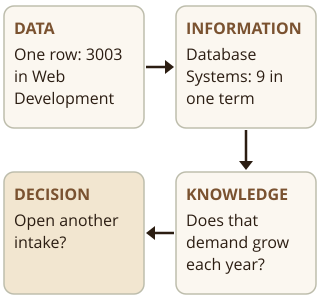

# Day 1 notes: Why a warehouse exists

These notes explain why the Thara Institute of Computing needs a data warehouse beside its registration system. Read them before the lab, and keep them open beside the slides.

## Before You Start

Set up your portable tools first, as [Getting started](../../getting-started.md) describes. The first launcher loads the institute's registration system into the database `thara`, and you look at it in the lab today.

Today starts the thread of ideas for the whole module. It builds on what you already know about relational databases, keys and SQL joins.

> **Note.** Every count on this page comes from the day's data manifest, and you can check each one in the lab. If your count differs, check the data before you check your SQL.

## What You Will Be Able To Do

- Compare the two kinds of work a database does, and say why one database cannot serve both well (LO1).
- Test a data store against the four properties of a warehouse (LO1).
- Trace a decision back through knowledge, information and data (LO1).
- Describe how decision support grew from printed reports to warehouses and dashboards (LO1).

## Key Words for Today

- **[OLTP](../../glossary.md#oltp)**: work that records events one row at a time, such as the desk adding one enrollment.
- **[OLAP](../../glossary.md#olap)**: work that reads many rows at once and groups them, such as enrollments per course for one term.
- **[Workload](../../glossary.md#workload)**: the kind of work a database does most of the time, such as the desk's small writes all day.
- **[Data warehouse](../../glossary.md#data-warehouse)**: a separate system that holds history for analysis, like the one you build this week.
- **[Subject-oriented](../../glossary.md#subject-oriented)**: organised around the subject people ask about, which for the Dean is enrollment.
- **[Integrated](../../glossary.md#integrated)**: every source uses one spelling for each value and one key for each student.
- **[Time-variant](../../glossary.md#time-variant)**: every row carries its time, as each enrollment carries its semester and academic year.
- **[Non-volatile](../../glossary.md#non-volatile)**: rows are loaded and read, not edited, so a report gives the same answer next month.
- **[Data](../../glossary.md#data)**: a recorded fact about one event, such as one enrollment row.
- **[Information](../../glossary.md#information)**: data with context, such as a count of enrollments for each course in one term.
- **[Knowledge](../../glossary.md#knowledge)**: a pattern you can act on, such as whether demand for a course grows each year.
- **[Decision support system](../../glossary.md#decision-support-system)**: a system that helps people move from data to a decision, such as a warehouse with its dashboards.

## Idea 1 of 3 - One database cannot do both jobs

It is enrollment week at the Thara Institute. The registration desk adds and changes one enrollment at a time, all day, for every student who comes to the counter.

Last year the Dean asked for enrollments per course, per term and per campus, over two years. Someone ran that large query on the live registration system during enrollment week, and the desk slowed to a crawl. So can one database serve the desk and the Dean at the same time?

> **Key idea.** The workload decides the design of a database. A system tuned for many small writes stores data in a way that makes large reads over history slow. Run the Dean's questions on the registration system, and the registration desk pays for every report.

A database does two kinds of work. OLTP, online transaction processing, records events one row at a time, with insert, update, delete and look-up. OLAP, online analytical processing, reads many rows at once and groups them to count, sum and compare.

The registration system is built for OLTP work. It stores each fact once, in four tables joined by keys, so its writes are fast and safe.

Now compare the two questions. The desk's question reads one enrollment, which the system finds by its key. The Dean's question reads every enrollment of a term and groups them. As terms pile up, every analytical read scans more rows, and the desk waits behind it.

> **Analogy.**
>
> **Familiar idea.** A supermarket cash register, and the company's accountant who prepares the year-end report.
>
> **The mapping.** The cash register records one sale at a time, quickly and exactly. The accountant reads a whole year of sales to find trends. So the register does OLTP work, and the accountant does OLAP work.
>
> **Where it breaks.** An accountant works from a copy of the year's sales, away from the till. A query on a live database reads the same tables the desk is writing, so the two jobs collide.
>
> **Back to the warehouse.** A warehouse is the accountant's own copy. It is loaded from the registration system, organised for reading, and never in the desk's way.

So the institute needs two systems: the registration system for the desk, and a warehouse for the Dean. It also needs a process that moves data from one to the other, which Days 3 and 4 build.

> **Thara.** The registration desk slowed to a crawl while the Dean's report ran during enrollment week.

> **Common mistake.** "A warehouse is just a bigger database." It is not: a warehouse is a separate system, organised for reading history.

> **Quick check.** The Registrar asks whether student 3003 is enrolled in Web Development this term. Is that an OLTP question or an OLAP question?
>
> - [x] OLTP, because it reads one enrollment by its key
> - [ ] OLAP, because the Registrar is a manager, not a desk clerk
> - [ ] OLAP, because the answer comes from the enrollments table
>
> **Why:** The question finds one record. Who asks it does not change the kind of work. An OLAP question reads many rows and groups them.

## Idea 2 of 3 - What makes a warehouse a warehouse

For a second attempt, the Dean combined spreadsheet exports from three offices of the institute.

The three exports gave three different totals for the same question. Each office counted correctly by its own rules. So which total is right, and how would anyone know?

> **Key idea.** A data warehouse is subject-oriented, integrated, time-variant and non-volatile. Those four properties let the same question return the same answer, from every office, every time. A store that lacks any one of them gives totals that nobody can trust or compare.

Here is what each property means for the institute.

- Subject-oriented means the warehouse is organised around enrollment, the subject the Dean asks about, not around the desk's screens.
- Integrated means every source uses one spelling for each value and one key for each student.
- Time-variant means every enrollment carries its term, so one term can be compared with the same term a year earlier.
- Non-volatile means rows are loaded and read, not edited, so a report gives the same answer next month.

Now test the registration system against these properties. It fails the test for campus, because the admissions office keeps campus in its own registry.

> **Analogy.**
>
> **Familiar idea.** A library with a circulation desk and a reference section.
>
> **The mapping.** The circulation desk lends and returns one book at a time, and its records change all day. The reference section holds books arranged by subject, gathered from many publishers, and kept unchanged for every reader.
>
> **Where it breaks.** A reference book is printed once and never grows. A warehouse grows every term, because each load adds new history to the old.
>
> **Back to the warehouse.** The warehouse is the reference section. It is arranged by subject, gathered from both sources, kept by term, and not edited in place.

So the Dean gets one number to trust, because every office's question reads the same integrated rows, each with its term.

> **Thara.** Three offices gave three totals, and the Registrar wants every disagreement made visible, not hidden.

> **Common mistake.** "The registration system is badly designed, because it cannot answer the Dean." It is not badly designed: it is designed well for the desk.

> **Quick check.** The registration system has no campus column, so campus lives in another office's file. Which property does that break for the Dean's campus question?
>
> - [ ] Time-variant, because campus changes over time
> - [x] Integrated, because the data for one question sits in two sources that do not share it
> - [ ] Non-volatile, because the desk edits rows
> - [ ] Subject-oriented, because campus is not a subject
>
> **Why:** To answer by campus, the warehouse must bring the admissions registry and the registration system together, with one key for each student. That is integration.

## Idea 3 of 3 - Decision support is a chain, not a report

Now the Dean asks whether the institute should open another intake of Database Systems next year.

The registration system holds every enrollment, so the data exists. Yet nobody can answer the question this week. So what is missing between the rows and the decision?

> **Key idea.** Data supports a decision only after it becomes information and then knowledge. A row records one event, and a decision needs a pattern across many events, read in context. A warehouse exists to shorten the path from stored rows to a decision someone can defend.

The chain has three links before the decision.

- Data is one row, for example student 3003 enrolled in Web Development in Semester 1 of 2024/2025.
- Information is data with context, for example Database Systems had 9 enrollments in Semester 1 of 2024/2025, more than any other course.
- Knowledge is a pattern you can act on, for example whether that demand grows from one year to the next.

A decision support system helps people move along that chain with their own questions. Decision support grew from printed operational reports, to systems managers query themselves, to warehouses and dashboards.

> **Analogy.**
>
> **Familiar idea.** A blood test at a clinic, with the laboratory report the doctor reads.
>
> **The mapping.** The laboratory report lists raw readings, which are data. The normal ranges printed beside them make the readings information. The doctor's experience turns the pattern into knowledge. The treatment is the decision.
>
> **Where it breaks.** A doctor decides for one patient at a time. The Dean decides for a whole institute, so the pattern must come from many rows, not from one person.
>
> **Back to the warehouse.** The warehouse is the laboratory that prepares the report. It turns enrollment rows into counts by course and term that the Dean can act on.

Every lab this week moves one step along the chain, from raw rows on Day 3 to a dashboard for the Dean on Day 6.

> **Thara.** The Dean's intake question meets a system that stores every row and answers none of it.

> **Common mistake.** "Any report is decision support." A report is not decision support until someone can act on the pattern it shows.

> **Quick check.** Database Systems had 9 enrollments in one term. Is that data, information or knowledge?
>
> - [ ] Data, because it is a number stored in a table
> - [ ] Knowledge, because the Dean can see it
> - [x] Information, because it is a count with its course and term around it
>
> **Why:** A count with its course and term around it is information. To turn it into knowledge, add the same count for other years and look for a pattern.

## Common Errors

- Calling a warehouse a bigger database, when it is a separate system organised for reading history.
- Blaming the registration system for being slow on the Dean's report, when it is designed well for the desk.
- Treating a printed report as decision support, when it supports a decision only once someone can act on its pattern.

## Self-Check

1. Why did the registration desk slow down when the Dean's report ran? *Answer:* The report read every enrollment of a term on the same tables the desk was writing, so OLAP work and OLTP work collided.
2. Name the four properties of a warehouse, and say which one the campus question breaks. *Answer:* The four are subject-oriented, integrated, time-variant and non-volatile, and the campus question breaks integrated, because campus lives in the admissions registry.
3. A count of 9 enrollments for one course in one term is information. What turns it into knowledge? *Answer:* The same count for other years, read as a pattern, such as growth from one year to the next.

## Words From Earlier Days

This is the first day, so there are no words from earlier days yet. You need what you already know about tables, keys and SQL joins. Look up any word from today in the [glossary](../../glossary.md).

## What Is Next

Day 2 builds a star schema on today's ideas. Bring the three questions you write in the lab, because Day 2 tests the star schema against them.

For extra reading, see Han, Kamber and Pei, *Data Mining: Concepts and Techniques*, the chapter on data warehousing. Read the part on what a data warehouse is.
